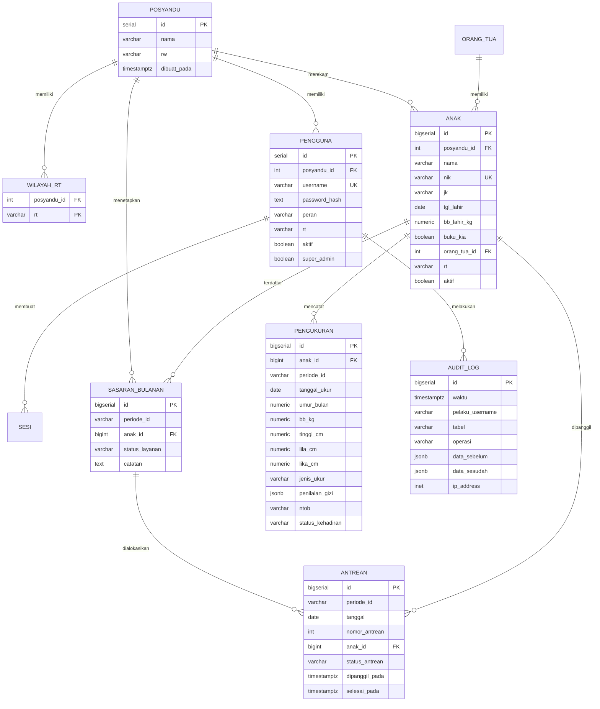
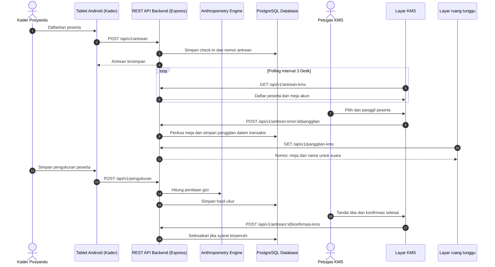

# DOKUMEN SERAH TERIMA ARSITEKTUR SISTEM & SPESIFIKASI TEKNIS
## SIMPATIK POSYANDU (Sistem Informasi Posyandu Terintegrasi dan Antropometri Digital)
**Program KKN Tematik 2026 — Posyandu Tulip RW 18**
*Versi Dokumen: 2.1-Modular · Tanggal: 1 November 2026 · Status: Final Handover*

---

## DAFTAR ISI
1. [BAB 1: Ringkasan Eksekutif & Prinsip Rekayasa](#bab-1-ringkasan-eksekutif--prinsip-rekayasa)
2. [BAB 2: Topologi Sistem & Tumpukan Teknologi](#bab-2-topologi-sistem--tumpukan-teknologi)
3. [BAB 3: Struktur Direktori Monorepo & Desain Modular](#bab-3-struktur-direktori-monorepo--desain-modular)
4. [BAB 4: Katalog Lengkap REST API & Kontrak Data](#bab-4-katalog-lengkap-rest-api--kontrak-data)
5. [BAB 5: Arsitektur Basis Data, ERD & Isolasi Sandbox](#bab-5-arsitektur-basis-data-erd--isolasi-sandbox)
6. [BAB 6: Flowchart & Alur Kode Sistem (Sequence Diagrams)](#bab-6-flowchart--alur-kode-sistem-sequence-diagrams)
7. [BAB 7: Matriks Hak Akses (RBAC) & Jejak Audit (Audit Trail)](#bab-7-matriks-hak-akses-rbac--jejak-audit-audit-trail)
8. [BAB 8: Panduan Operasional, Migrasi & Runbook Pemeliharaan](#bab-8-panduan-operasional-migrasi--runbook-pemeliharaan)

---

## BAB 1: RINGKASAN EKSEKUTIF & PRINSIP REKAYASA

### 1.1 Latar Belakang & Visi Transformasi Digital
Posyandu Tulip RW 18 melayani balita dan keluarga di 7 RT binaan. Sebelum digitalisasi, alur pencatatan menggunakan 12 lembar berkas manual dan file spreadsheet yang terfragmentasi. Kesalahan pembacaan tabel cetak pertumbuhan WHO, keterlambatan pelaporan F1 Puskesmas, serta risiko kehilangan kartu fisik menjadi kendala berulang.

SIMPATIK Posyandu dirancang sebagai sistem terintegrasi yang menghubungkan:
1. **Aplikasi Lapangan Tablet Android:** Pencatatan penimbangan, pendaftaran mandiri cepat via QR code, dan antrean real-time.
2. **Web Portal Kader & Tenaga Kesehatan (Bidan/Dokter):** Pemeriksaan KMS interaktif, manajemen sasaran bulanan, analisis grafik pertumbuhan multi-indeks, dan ekspor instan F1 resmi.
3. **Penyimpanan Terpusat & Sinkronisasi Cerdas:** Basis data PostgreSQL berstandar audit klinis, siap beroperasi di jaringan lokal (offline LAN) maupun terhubung internet (Cloudflare Tunnel).

### 1.2 Prinsip Inti Rekayasa Sistem (Engineering Tenets)
Sistem ini dibangun berdasarkan 5 prinsip integritas data fundamental:
- **DR-01 (Non-Destructive Target Updates):** Pergantian atau penerbitan sasaran bulanan baru tidak pernah menghapus master profil anak, kartu QR, atau riwayat ukur yang pernah dicatat.
- **DR-02 (Server Authoritative Anthropometrics):** Semua vonis status gizi, z-score, dan validasi medis dihitung dan diverifikasi secara mutlak di sisi server berdasarkan acuan Permenkes No. 2 Tahun 2020 dan parameter LMS WHO 2006. Antarmuka web hanya menghitung salinan pratinjau yang diverifikasi oleh rangkaian test suite.
- **DR-03 (Absence is Not Zero Measurement):** Balita yang tidak hadir tidak pernah diisi dengan berat badan `0 kg`. Ketidakhadiran, status pindah, atau alasan medis dicatat secara semantik pada kolom status kehadiran.
- **DR-04 (Dual-Schema Sandbox Isolation):** Sesi pelatihan kader (Mode Pelatihan) berjalan 100% pada skema basis data terpisah (`latihan_<uuid>`). Modifikasi, simulasi penimbangan, atau penghapusan data uji coba tidak pernah menyentuh skema operasional `public`.
- **DR-05 (Zero Critical External Dependencies):** Seluruh logika autentikasi (scrypt + session token), pembatas laju percobaan masuk (rate limiter), generator sheet Excel F1, dan mesin interpolasi LMS ditulis mandiri tanpa pustaka pihak ketiga berlebih, menjamin portabilitas dan keamanan jangka panjang.

---

## BAB 2: TOPOLOGI SISTEM & TUMPUKAN TEKNOLOGI

### 2.1 Arsitektur Jaringan Dual-Mode (Offline LAN & Hybrid Cloud)

```
[ KELUARGA / KADER ]
        |
        v
[ Kartu QR Balita ]
        |
        +-------------------------------------------------------+
        |                                                       |
        v                                                       v
[ Tablet Kader 1: Pendaftaran ]                         [ Tablet Kader 2: Pengukuran ]
  - Android App / Chrome PWA                              - Android App / Chrome PWA
  - Offline Local Queue Storage                           - Fast Measurement Entry
        |                                                       |
        +---------------------------+---------------------------+
                                    |
                    [ Router WiFi Posyandu (LAN) ]
                                    |
        +---------------------------+---------------------------+
        | (Jaringan Lokal)                                      | (Koneksi Internet)
        v                                                       v
[ Server Fisik Posyandu / Mini PC ]                     [ Cloudflare Zero-Trust Tunnel ]
  - Node.js 24 + Express 5 Core                           - *.trycloudflare.com / Domain
  - PostgreSQL 16+ Database                                     |
  - Vite React 19 Frontend Web Portal                           v
        |                                       [ Laptop Bidan / Dokter / Pengurus RW ]
        v                                         - Layar Pemeriksaan KMS Real-Time
[ Layar Pemeriksaan KMS Bidan ]                   - Manajemen Pengguna & Sasaran
  - Web UI: Auto-Refresh / Real-time Poll         - Ekspor Laporan Bulanan F1 Excel
```

### 2.2 Matriks Tumpukan Teknologi (Technology Stack Matrix)

| Lapisan Sistem | Komponen / Pustaka | Versi | Peran & Justifikasi |
|---|---|---|---|
| **Frontend Framework** | React + TypeScript | React 19 / TS 5.9 | UI reaktif modern dengan state manajemen murni, zero external state bloat |
| **Frontend Build Tool** | Vite | 8.3 | Bundling super cepat (1.5 detik), modular HMR, kompatibilitas PWA |
| **CSS & Styling** | Tailwind CSS v4 | v4.0 | Utilitas desain sistem terkonsolidasi, konsistensi warna semantik (`tone-green`, `tone-amber`, `tone-red`, `tone-blue`) |
| **Ikonografi & QR** | Lucide React / qrcode.react | Latest | Simbol antarmuka standar aksesibilitas dan generator barcode QR kartu |
| **Backend Runtime** | Node.js (Type Stripping) | v22 / v24 | Eksekusi file TypeScript langsung tanpa proses kompilasi manual perantara |
| **HTTP Framework** | Express | v5.0 | Routing decoupled REST API, middleware otentikasi kustom, pemrosesan streaming |
| **Basis Data Relasional** | PostgreSQL | 16 / 17 | Relasional ACID rigid, skema dinamis (sandbox mode), audit trigger otomatis |
| **Database Driver** | `pg` (node-postgres) | Native Pool | Query SQL murni tulisan tangan tanpa ORM, kendali performa dan isolasi transaksi |
| **Autentikasi & Kripto** | Node.js `crypto` (`scrypt`) | Bawaan | Hash password aman tahan serangan GPU, session cookie berbasis httpOnly/SameSite |
| **Test Harness** | `node:test` + Node Assert | Bawaan | Menjalankan 296 pengujian server dan 75 pengujian client dalam hitungan detik |

---

## BAB 3: STRUKTUR DIREKTORI MONOREPO & DESAIN MODULAR

### 3.1 Struktur Direktori Monorepo
Kode sumber terorganisir rapi dalam satu monorepo yang memisahkan aplikasi server dan aplikasi web client:

```text
kkn_posyandu_tulip/
├── client/                     # Frontend Application (React 19 + Vite)
│   ├── index.html              # HTML Entry Point & PWA Manifest Links
│   ├── vite.config.ts          # Vite Configuration & Backend Proxy
│   ├── src/
│   │   ├── main.tsx            # React Bootstrap DOM
│   │   ├── app.tsx             # Root Application Shell
│   │   ├── layar.tsx           # Client-side View Router & Screen Dispatcher
│   │   ├── components/         # Komponen UI Global (Dialog, Table, Badges, KMS Chart)
│   │   ├── lib/                # Helper Format, Z-score, Pesan WhatsApp, Lembar Hasil
│   │   ├── pages/              # Modul Halaman Aplikasi (Modular State-of-the-Art)
│   │   │   ├── anak/           # Modul Data Balita & Detail Pertumbuhan
│   │   │   │   ├── index.tsx   # Orchestrator Daftar Balita (~240 baris)
│   │   │   │   ├── show.tsx    # Orchestrator Detail Balita (~350 baris)
│   │   │   │   ├── daftar/     # Sub-komponen modular daftar balita
│   │   │   │   │   ├── tipe.ts
│   │   │   │   │   ├── filter-anak.tsx
│   │   │   │   │   ├── tabel-anak.tsx
│   │   │   │   │   ├── editor-baris.tsx
│   │   │   │   │   ├── form-tambah.tsx
│   │   │   │   │   └── baris-penanda.tsx
│   │   │   │   └── detail/     # Sub-komponen modular detail anak
│   │   │   │       ├── tipe.ts
│   │   │   │       ├── status-naik.tsx
│   │   │   │       ├── kartu-indeks.tsx
│   │   │   │       ├── tab-profil.tsx
│   │   │   │       ├── tab-status.tsx
│   │   │   │       ├── tab-kurva.tsx
│   │   │   │       ├── tab-grafik.tsx
│   │   │   │       ├── tab-riwayat.tsx
│   │   │   │       ├── dialog-ubah.tsx
│   │   │   │       └── dialog-cetak.tsx
│   │   │   ├── pengaturan/     # Modul Konfigurasi Sistem
│   │   │   │   ├── index.tsx   # Orchestrator Tab Pengaturan (~260 baris)
│   │   │   │   ├── tipe.ts
│   │   │   │   ├── komponen/   # Komponen umum pengaturan (isian-angka, bilah-simpan)
│   │   │   │   └── bagian/     # Sub-komponen tiap bagian pengaturan
│   │   │   │       ├── bagian-batas.tsx
│   │   │   │       ├── bagian-ambang.tsx
│   │   │   │       ├── bagian-pengguna.tsx
│   │   │   │       ├── bagian-standar.tsx
│   │   │   │       ├── bagian-riwayat.tsx
│   │   │   │       └── dialog-pengguna.tsx
│   │   │   ├── sasaran/        # Modul Sasaran Layanan & Impor Excel
│   │   │   │   ├── index.tsx   # Orchestrator Sasaran (~320 baris)
│   │   │   │   └── komponen/   # Sub-komponen sasaran & impor
│   │   │   │       ├── tipe.ts
│   │   │   │       ├── panel-impor.tsx
│   │   │   │       ├── tabel-sasaran.tsx
│   │   │   │       ├── dialog-tambah-sasaran.tsx
│   │   │   │       ├── dialog-edit-sasaran.tsx
│   │   │   │       └── dialog-reset-sasaran.tsx
│   │   │   ├── kms/            # Pemeriksaan KMS Bidan (Live Queue Screen)
│   │   │   ├── dashboard.tsx   # Monitoring Eksekutif & Ringkasan Kehadiran
│   │   │   ├── laporan.tsx     # Rekapitulasi Laporan SKDN & Analisis Bulanan
│   │   │   ├── masuk.tsx       # Autentikasi Pengguna
│   │   │   └── sesi-pelatihan.tsx # Pengendali Sandbox Sesi Pelatihan
│   ├── test/                   # Unit & Regression Test Client (75 test cases)
├── server/                     # Backend Application (Node.js + Express 5)
│   ├── src/
│   │   ├── main.ts             # Server Entry Point, Port Binding & Shutdown
│   │   ├── app.ts              # Express Composition & Middleware Stack
│   │   ├── antropometri/       # Engine Standar WHO 2006, LMS, Tabel KBM
│   │   ├── auth/               # Logika Peran, Sesi, Hash Scrypt, Aksesibilitas
│   │   ├── db/                 # Pool PostgreSQL, Transaksi, Audit CDC Logging
│   │   ├── http/               # Controllers, Route Guards, Error Handlers
│   │   ├── repositories/       # Abstraksi Query SQL Murni PostgreSQL
│   │   └── services/           # Logika Bisnis, Sandbox Orchestrator, Excel Generator
│   ├── db/migrations/          # 28 File Migrasi SQL Berurutan
│   ├── test/                   # 296 Unit, Integration, & Contract Tests
└── docs/                       # Dokumentasi Arsitektur, Basis Data, Panduan Operasi
```

### 3.2 Keuntungan Pola Desain Modular Baru (State-of-the-Art)
Sebelum refaktor, halaman utama memiliki ukuran monolitik besar (`show.tsx` 1.743 baris, `pengaturan/index.tsx` 1.682 baris, `anak/index.tsx` 1.480 baris, `sasaran/index.tsx` 1.305 baris).

Dengan arsitektur modular saat ini:
1. **Single Responsibility Principle (SRP):** Setiap subkomponen hanya bertanggung jawab atas satu bagian tampilan (misalnya `tab-kurva.tsx` hanya mengurus rendering kurva WHO).
2. **Navigasi Cepat & Cognitive Load Rendah:** Developer baru dapat langsung menemukan file relevan tanpa menelusuri ribuan baris kode.
3. **Isolasi Bug & Hot-Reload Efisien:** Perubahan styling atau logika pada satu dialog tidak memicu re-render atau resiko regresi pada tab lainnya.
4. **100% Backward-Compatible Re-exports:** Semua tipe dan fungsi publik tetap diekspor dari file `index.tsx` dan `show.tsx`, menjaga seluruh import eksternal tetap valid tanpa breaking changes.

---

## BAB 4: KATALOG LENGKAP REST API & KONTRAK DATA

Semua endpoint diawali dengan prefix `/api` dan menggunakan format JSON murni.

### 4.1 Autentikasi & Akun Pengguna

#### `POST /api/masuk`
- **Tujuan:** Autentikasi pengguna (Admin, Bidan, Kader, Petugas KMS).
- **Request Body:**
  ```json
  {
    "username": "kader01",
    "kataSandi": "rahasia123"
  }
  ```
- **Response `200 OK`:**
  - Mengembalikan objek profil pengguna dan memasang Cookie `sesi` bertipe `httpOnly; SameSite=Lax; Secure`.
  ```json
  {
    "id": 1,
    "username": "kader01",
    "nama": "Siti Nurhaliza",
    "peran": "kader",
    "posyanduId": 1,
    "posyanduNama": "Posyandu Tulip",
    "rw": "18",
    "rt": "01",
    "superAdmin": false
  }
  ```

#### `POST /api/keluar`
- **Tujuan:** Menghapus token sesi aktif di basis data dan membersihkan cookie peramban.
- **Response `200 OK`:** `{"pesan": "Berhasil keluar"}`

#### `GET /api/saya`
- **Tujuan:** Mengecek status autentikasi aktif dari cookie browser.
- **Response `200 OK`:** Mengembalikan data identitas pengguna saat ini.

---

### 4.2 Master Balita & Profil Pertumbuhan

#### `GET /api/anak`
- **Query Params:** `rt` (opsional), `cari` (opsional), `lingkup` (`aktif` | `arsip`), `periode` (`YYYY-MM`).
- **Response `200 OK`:** Daftar balita beserta hasil ukur terakhir dan status perhatian.
  ```json
  [
    {
      "anakId": 101,
      "nama": "Ahmad Faris",
      "nik": "3201012304210001",
      "nikLengkap": true,
      "jk": "L",
      "umurBulan": 28,
      "rt": "01",
      "namaOrtu": "Nurul",
      "tanggalUkurTerakhir": "2026-10-09",
      "kategoriGizi": "Gizi baik",
      "perluPerhatian": false,
      "risikoLahir": null,
      "bbKg": 12.4,
      "tinggiCm": 89.5
    }
  ]
  ```

#### `GET /api/anak/:id`
- **Tujuan:** Mengambil profil lengkap balita, riwayat pengukuran lintas bulan, dan kurva WHO.
- **Response `200 OK`:**
  ```json
  {
    "anak": {
      "id": 101,
      "nama": "Ahmad Faris",
      "nik": "3201012304210001",
      "tglLahir": "2024-06-15",
      "jk": "L",
      "rt": "01",
      "namaOrtu": "Nurul",
      "bukuKia": true
    },
    "pengukuran": [
      {
        "periodeId": "2026-10",
        "tanggalUkur": "2026-10-09",
        "umurBulan": 28,
        "bbKg": 12.4,
        "tinggiCm": 89.5,
        "penilaian": {
          "BB_TB": { "z": 0.12, "kategori": "Gizi baik" },
          "BB_U": { "z": -0.45, "kategori": "Berat badan normal" },
          "TB_U": { "z": -0.65, "kategori": "Normal" }
        },
        "ntob": "N"
      }
    ]
  }
  ```

---

### 4.3 Layanan Antrean & Pemeriksaan KMS Real-Time

Peserta dapat masuk antrean setelah check-in, sebelum pengukuran. Layar KMS membaca `GET /api/v1/antrean-kms`; tindakan per meja memakai `POST /api/v1/antrean-kms/:id/panggilan`, dan layar ruang tunggu membaca `GET /api/v1/panggilan-kms`. Konfirmasi memakai `POST /api/v1/antrean/:id/konfirmasi-kms` setelah syaratnya terpenuhi. Bentuk payload, izin dan galat ada di [kontrak API bagian 3.4](SIMPATIK_Posyandu_REST_API_Contract.md#34-antrean--pemeriksaan-kms-real-time).

---

### 4.4 Sasaran Layanan & Impor File Excel Puskesmas

#### `POST /api/sasaran/periksa`
- **Tujuan:** Mengunggah file workbook `.xlsx` untuk dipindai header dan sheet periodenya.
- **Payload:** Multipart Form Data (`berkas`: file binary .xlsx).
- **Response `200 OK`:**
  ```json
  {
    "isiBase64": "UEsDBBQAAAAIA...",
    "sheets": [
      {
        "sheet": "Oktober 2026",
        "periode": "2026-10",
        "labelPeriode": "Oktober 2026",
        "jumlahBaris": 92,
        "jumlahSiap": 92,
        "jumlahPerluVerifikasi": 0,
        "jumlahDitahan": 0
      }
    ]
  }
  ```

#### `POST /api/sasaran/ganti`
- **Tujuan:** Menerbitkan sheet terpilih menjadi sasaran aktif perangkat Android.
- **Request Body:**
  ```json
  {
    "namaFile": "Format_Sasaran_Puskesmas.xlsx",
    "isiBase64": "UEsDBBQAAAAIA...",
    "sheet": "Oktober 2026"
  }
  ```
- **Response `201 Created`:**
  ```json
  {
    "periode": "2026-10",
    "jumlahSasaran": 92,
    "anakBaru": 3,
    "anakDiperbarui": 89
  }
  ```

#### `POST /api/sasaran/reset-hari-ini`
- **Tujuan:** Menghapus hasil ukur dan antrean bertanggal hari ini pada periode aktif (tindakan darurat jika ada kesalahan fatal).
- **Request Body:**
  ```json
  {
    "periodeId": "2026-10",
    "konfirmasi": "RESET HARI INI"
  }
  ```

---

### 4.5 Mesin Dual-Mode Sesi Pelatihan (Sandbox Isolation)

#### `GET /api/sandbox/status`
- **Response `200 OK`:**
  ```json
  {
    "aktif": true,
    "schema": "latihan_8f4b12c9_6a21",
    "dimulaiPada": "2026-10-31T08:15:00Z",
    "dimulaiOleh": "superadmin",
    "periodeSumber": "2026-10",
    "jumlahSasaran": 92
  }
  ```

#### `POST /api/sandbox/mulai`
- **Tujuan:** Menginisiasi skema PostgreSQL baru, menyalin sasaran tersamar, dan beralih ke mode sandbox.
- **Request Body:** `{"periodeSumber": "2026-10"}`
- **Response `201 Created`:** `{"status": "aktif", "schema": "latihan_..."}`

#### `POST /api/sandbox/akhiri`
- **Tujuan:** Menjatuhkan (*drop cascade*) skema `latihan_*` dan mengembalikan server ke skema operasional `public`.
- **Response `200 OK`:** `{"status": "selesai", "dataDibersihkan": true}`

---

## BAB 5: ARSITEKTUR BASIS DATA, ERD & ISOLASI SANDBOX

### 5.1 Diagram Relasi Entitas (ERD)



### 5.2 Mekanisme Isolasi Skema Sandbox (Dual-Schema Training Sandbox)
Sistem memecahkan masalah klasik "bagaimana kader dapat latihan di perangkat riil tanpa mengotori data asli" melalui isolasi level schema PostgreSQL:

1. **Pemisahan Skema Dinamis:** Saat Sesi Pelatihan aktif, backend membuat skema sementara `CREATE SCHEMA latihan_<session_uuid>`.
2. **Duplikasi Metadata & Data Disamarkan:**
   - Tabel `anak`, `sasaran_bulanan`, `pengukuran`, `antrean` disalin ke skema latihan.
   - NIK anak diubah ke awalan `0099...` dan nama keluarga disamarkan otomatis.
   - ID internal dimulai dari offset `1.000.000.000.000`.
3. **Penyetelan `search_path` Otomatis:** Koneksi klien dialihkan menggunakan `SET search_path = latihan_<uuid>`. Query database yang dieksekusi secara otomatis membaca dan menulis hanya pada tabel latihan.
4. **Pembersihan Total (*Clean Drop*):** Begitu superadmin menekan "Akhiri Sesi", backend menjalankan `DROP SCHEMA latihan_<uuid> CASCADE;`. Basis data produksi `public` dijamin tetap 100% murni dan tak tersentuh.

---

## BAB 6: FLOWCHART & ALUR KODE SISTEM

### 6.1 Alur Pengukuran & Bridging ke Layar Pemeriksaan KMS



### 6.2 Alur Perhitungan Antropometri WHO LMS 2006
1. **Normalisasi Umur & Kunci:** Umur dihitung tepat terhadap tanggal kegiatan (`umurBulanPada`).
2. **Pemilihan Indeks:**
   - Usia 0–23 bulan: Indeks panjang badan (`BB_PB`, `PB_U`).
   - Usia 24–60 bulan: Indeks tinggi badan (`BB_TB`, `TB_U`).
3. **Koreksi Posisi Ukur Otomatis (Opsional):** Jika anak <24 bulan diukur berdiri, ditambah `0.7 cm`; jika anak >=24 bulan diukur telentang, dikurangi `0.7 cm`.
4. **Formula LMS WHO:**
   $$\text{Jika } L \neq 0: \quad Z = \frac{\left(\frac{y}{M}\right)^L - 1}{L \cdot S}$$
   $$\text{Jika } L = 0: \quad Z = \frac{\ln\left(\frac{y}{M}\right)}{S}$$
5. **Koreksi WHO Ekstrem ($Z > +3$ atau $Z < -3$):** Penyesuaian deviasi standar eksternal untuk mencegah distorsi bobot anak gizi buruk atau obesitas berat.

---

## BAB 7: MATRIKS HAK AKSES (RBAC) & JEJAK AUDIT

### 7.1 Matriks Peran Pengguna (Role-Based Access Control)

| Hak Akses / Kapabilitas | Superadmin | Admin Posyandu | Bidan / Nakes | Kader Lapangan | Petugas KMS |
|---|:---:|:---:|:---:|:---:|:---:|
| Masuk ke Web & APK | Ya | Ya | Ya | Ya | Ya |
| Kelola Akun & Kata Sandi | Semua Akun | Akun Posyandunya | Tidak | Tidak | Tidak |
| Konfigurasi Ambang & Standar | Ya | Ya | Ya | Tidak | Tidak |
| Impor & Ganti Sasaran Excel | Ya | Ya | Tidak | Tidak | Tidak |
| Reset Sesi Hari Ini (Darurat) | Ya | Ya | Tidak | Tidak | Tidak |
| Entri & Koreksi Pengukuran | Ya | Ya | Ya | Binaan RT | Hanya Baca |
| Pemeriksaan & Edukasi KMS | Ya | Tidak | Tidak | Tidak | Ya |
| Ekspor Laporan Bulanan F1 | Ya | Ya | Ya | Tidak | Tidak |
| Mulai / Akhiri Sesi Pelatihan | Ya | Tidak | Tidak | Tidak | Tidak |

### 7.2 Proteksi Admin Aktif Terakhir & Superadmin
Sistem menyertakan validasi level basis data dan middleware:
- **Last Admin Standing Guard:** Admin aktif terakhir dalam sebuah posyandu tidak dapat dinonaktifkan atau diturunkan perannya agar posyandu tidak terkunci (*lockout*).
- **Superadmin Immunity:** Akun superadmin global dilindungi dari mutasi yang tidak disengaja.

### 7.3 Jejak Audit Kriptografis (Change Data Capture)
Setiap mutasi `INSERT`, `UPDATE`, `DELETE` pada tabel kritis tercatat di `audit_log`:
- Perekaman identitas username, IP client, dan timestamp mikrodetik.
- Penyimpanan payload `data_sebelum` dan `data_sesudah` dalam format JSONB.
- Pergantian kata sandi dicatat peristiwanya tanpa pernah membocorkan string password atau hash.

---

## BAB 8: PANDUAN OPERASIONAL, MIGRASI & RUNBOOK PEMELIHARAAN

### 8.1 Manajemen Layanan Produksi (Systemd Service)
Pada server produksi Ubuntu/Debian, aplikasi dijalankan di bawah systemd unit `simpatik-user.service`:

```bash
# Memeriksa status service
systemctl --user status simpatik-user.service

# Membaca log transaksi real-time
journalctl --user -u simpatik-user.service -f

# Me-restart service backend
systemctl --user restart simpatik-user.service
```

> [!WARNING]
> Jangan menjalankan `git pull` atau me-restart service di server produksi selama jam operasional Posyandu berlangsung tanpa persetujuan tim medis.

### 8.2 Eksekusi Migrasi Basis Data PostgreSQL
Migrasi tersimpan dalam direktori `server/db/migrations/` dan dieksekusi secara berurutan:
```bash
cd server
npm run migrate
```

### 8.3 Prosedur Cadangan (Backup) & Pemulihan (Disaster Recovery)

```bash
# Melakukan backup database terkompresi
pg_dump -U postgres -d posyandu_tulip -Fc > posyandu_backup_$(date +%Y%m%d_%H%M%S).dump

# Memulihkan database dari file backup
pg_restore -U postgres -d posyandu_tulip --clean --if-exists posyandu_backup_20261101_120000.dump
```

### 8.4 Standar Operasional Prosedur (SOP) Hari Penimbangan Posyandu

#### H-1 (Persiapan Sistem):
1. Buka menu **Sasaran & Impor** di web portal, pastikan sheet periode bulan berjalan (misal: `November 2026`) sudah berstatus aktif.
2. Periksa bahwa mode pelatihan tidak sedang berjalan (tanda merah sandbox tidak boleh aktif).
3. Nyalakan laptop posyandu dan router Wi-Fi lokal, pastikan seluruh tablet terhubung ke SSID posyandu.

#### Hari H (Pelaksanaan di Lapangan):
1. **Meja 1 (Pendaftaran):** Kader memindai QR code kartu anak atau mencari nama di tablet. Anak didaftarkan ke antrean penimbangan.
2. **Meja 2 (Penimbangan):** Kader menimbang BB dan mengukur TB/PB. Data disimpan di tablet dan langsung mengalir ke server lokal.
3. **Meja 3 (Pemeriksaan KMS Bidan):** Dokter atau bidan melihat balita yang masuk di menu **Pemeriksaan KMS**, membaca grafik z-score, memberikan edukasi gizi, lalu menekan konfirmasi.

#### Pasca Acara (Pelaporan & Arsip):
1. Buka menu **Laporan** -> **Unduh F1 Excel**.
2. File Excel otomatis terisi lengkap sesuai standar format laporan gizi Puskesmas (Format F1 RT 1 s/d RT 7, raw data, serta rekapitulasi gizi SKDN).
3. Jalankan backup database harian.

---
*Dokumen ini disusun dan diserahkan secara resmi sebagai bagian dari artefak rekayasa sistem terintegrasi SIMPATIK Posyandu KKN Tematik 2026.*
