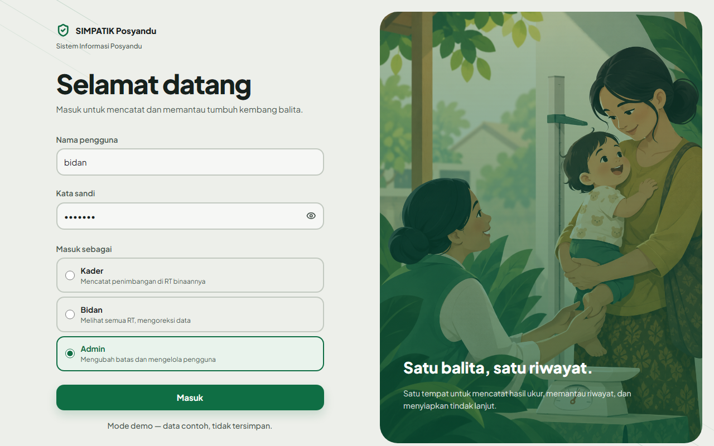
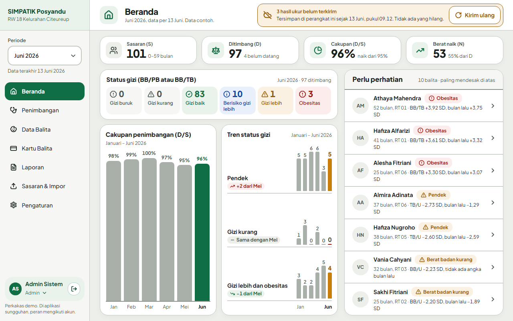
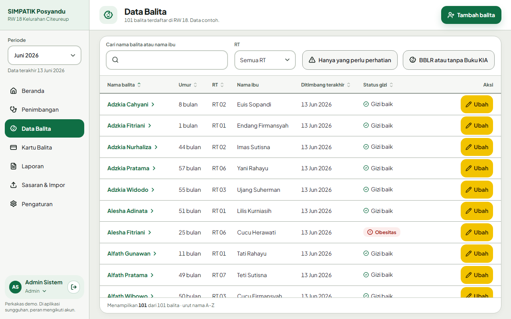
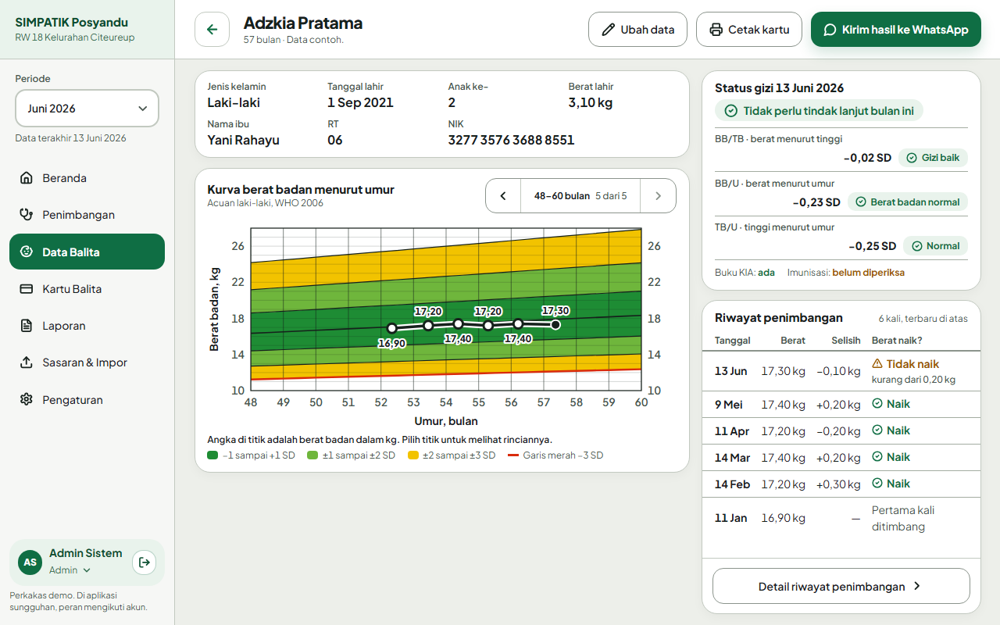
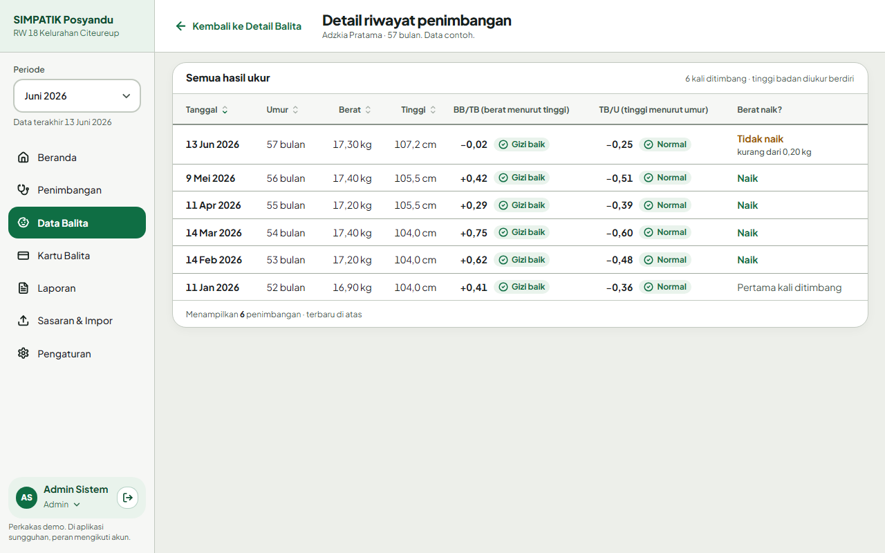
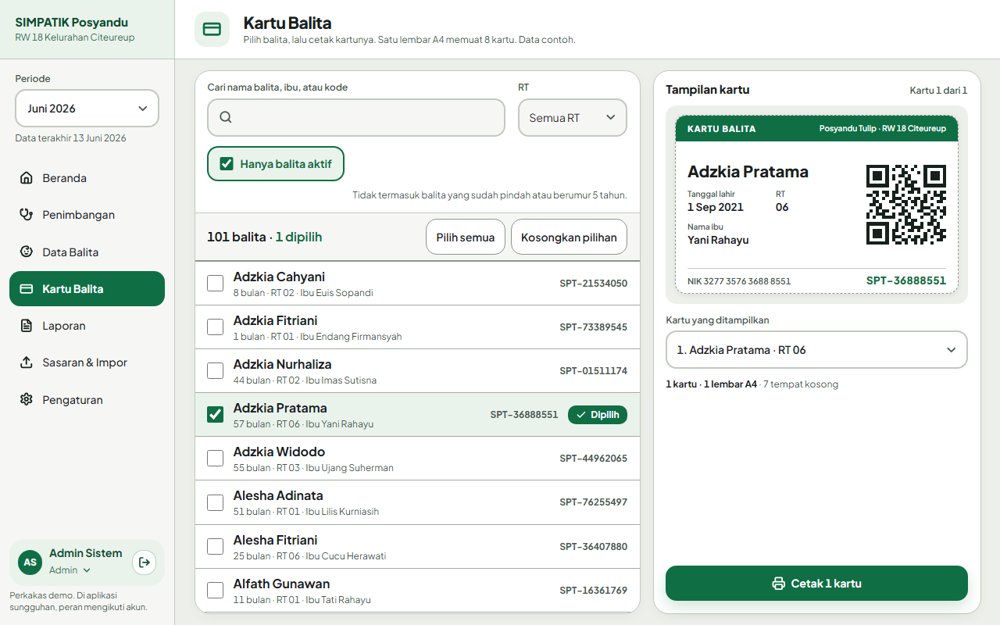
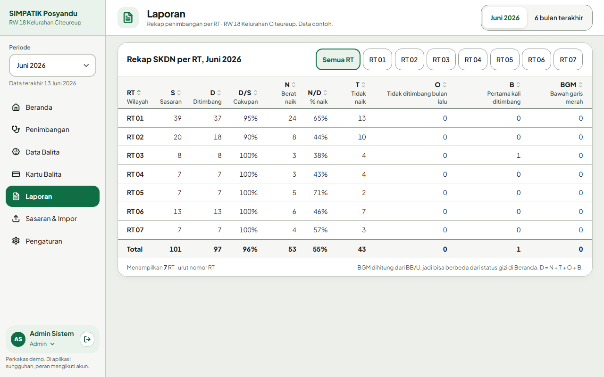
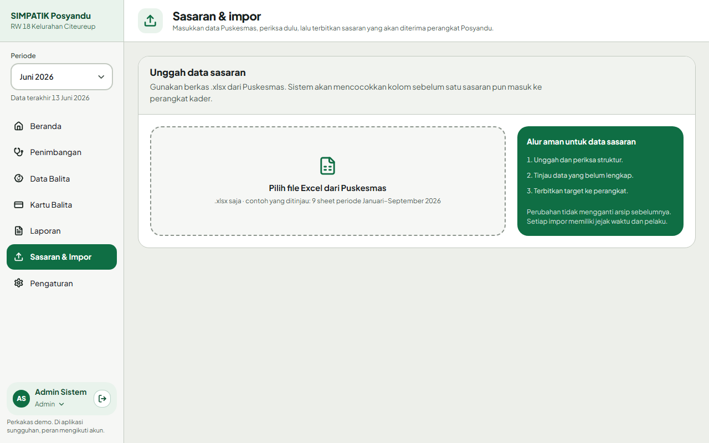
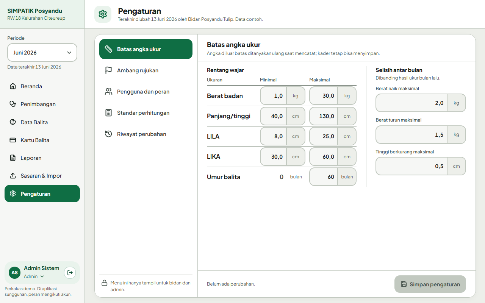

# Mulai di sini

| | |
|---|---|
| **Jenis** | Orientasi |
| **Status** | Final Approved / v2.1-Modular |
| **Perubahan berarti terakhir** | 1 November 2026 |

Halaman pertama bagi anggota tim baru. Isinya: aplikasi ini apa, layarnya apa saja, siapa yang memakainya, dan apa yang dibaca berikutnya. Sekitar sepuluh menit.

Dokumen teknis komprehensif pelengkap:
- [Handover arsitektur](arsitektur-sistem-handover.md)
- [Kontrak REST API](SIMPATIK_Posyandu_REST_API_Contract.md)
- [Komponen web](SIMPATIK_Posyandu_Web_Components.md)

---

## Aplikasi ini apa

**SIMPATIK Posyandu** adalah aplikasi web internal Posyandu Tulip, RW 18 Kelurahan Citeureup. Kader, bidan, petugas KMS, dan admin memakainya untuk mengelola sasaran, memantau status gizi, mengelola antrean KMS, dan menyusun laporan bulanan. Pengukuran balita dicatat di meja ukur melalui aplikasi Android (APK v1.6) yang tersinkronisasi offline-first secara atomik ke server. Sistem ini menggantikan puluhan berkas Excel yang selama ini dicocokkan dengan tangan.

Status gizi dihitung otomatis dari standar WHO 2006 dengan kategori PMK No. 2 Tahun 2020.

Dokumen yang lebih lama menyebutnya **Portal Posyandu Tulip**, atau cukup **Portal**. Ketiganya aplikasi yang sama; nama SIMPATIK dipakai di layar sejak 24 September 2026. "Portal" tetap dipakai untuk membedakannya dari **Aplikasi Tablet**, aplikasi Android terpisah untuk meja penimbangan yang pemindai kartunya (v1.6) sudah dipakai ([ADR-0003](adr/0003-batas-portal-vs-aplikasi-tablet.md)).

### Yang sudah nyata hari ini

| Bagian | Keadaan |
|---|---|
| Masuk, keluar, dan lima peran (Kader, Bidan, Admin, Petugas KMS, Superadmin) | Tersambung ke basis data; hak akses RBAC ditegakkan server |
| Pengaturan › Pengguna dan peran | Tersambung ke basis data dengan jejak audit |
| Perhitungan status gizi | Berjalan di server dan teruji terhadap 2.076 kasus acuan WHO LMS |
| Data Balita & Profil | Tersambung ke REST API live; arsitektur modular (`pages/anak/`), filter aktif/arsip, kelompok Desil, KB Ibu, dan grafik kurva KIA |
| Beranda, Laporan, Sasaran, dan KMS | Tersambung ke basis data live; filter RT, Real D/S hari H, ekspor resmi Excel F1, antrean KMS real-time |
| Sesi Pelatihan Sandbox | Terisolasi di skema PostgreSQL `latihan_<uuid>` tanpa mencemari data riil produksi |
| Input pengukuran | Di aplikasi Android; sinkronisasi server terintegrasi dengan transaksi atomik dan dedup |

Rinciannya di [Fitur](fitur.md).

---

## Peta layar

Sepuluh layar setelah masuk, ditambah layar Masuk. Alamatnya memakai tanda `#`, misalnya `#/balita/19`. Berkas halamannya ada di `client/src/pages/`. Struktur komponen menganut arsitektur modular (Single Responsibility Principle) dengan sub-komponen terisolasi di folder masing-masing.

| No. | Layar (nama menu) | Alamat | Peran | Untuk apa | Berkas |
|---|---|---|---|---|---|
| — | Masuk | — | semua | Nama pengguna dan kata sandi | `auth/login.tsx` |
| 1 | Beranda | `#/beranda` | K · B · A | Ringkasan bulan berjalan, filter RT, sebaran status gizi, dan Real D/S | `dashboard.tsx` |
| 2 | Data Balita | `#/balita` | K · B · A | Daftar balita: cari, saring aktif/arsip/RT, tambah, dan ubah | `anak/index.tsx` (modular) |
| 3 | Detail Balita | `#/balita/{id}` | K · B · A | Identitas (Desil, KB), KMS, grafik 6 indeks kurva KIA, status gizi & KIA | `anak/show.tsx` (modular) |
| 4 | Detail riwayat penimbangan | `#/balita/{id}/riwayat` | K · B · A | Semua hasil ukur satu balita | `anak/riwayat.tsx` (modular) |
| 5 | Pemeriksaan KMS | `#/kms` | KMS · A | Antrean balita real-time menunggu penjelasan hasil ukur dan konfirmasi selesai | `kms/index.tsx` |
| 6 | Kartu Balita | `#/kartu-sasaran` | B · A | Pilih balita, lalu cetak kartu ber-QR A4 (8 kartu/lembar) | `kartu-sasaran/index.tsx` |
| 7 | Laporan | `#/laporan` | K · B · A | Rekap SKDN per RT, z-score, riwayat 2T+, dan ekspor resmi Excel F1 & Buku 7 | `laporan/index.tsx` |
| 8 | Sasaran & Impor | `#/sasaran` | A | Pratinjau staging, validasi, dan penerbitan sasaran live dari berkas Excel | `sasaran/index.tsx` (modular) |
| 9 | Pengaturan | `#/pengaturan` | B · A | Batas angka ukur, ambang rujukan, akun pengguna, dan standar perhitungan | `pengaturan/index.tsx` (modular) |
| 10 | Sesi Pelatihan | `#/pelatihan` | Superadmin (Mirae) | Kontrol simulasi mode pelatihan dual-schema PostgreSQL tanpa mengubah data riil | `pelatihan/index.tsx` |

K = Kader, B = Bidan, A = Admin, KMS = Petugas KMS, Superadmin = Pengelola Global (Mirae). Detail Balita dan Detail riwayat penimbangan tidak punya menu sendiri; keduanya dibuka dari Data Balita atau Beranda.

Tangkapan di bawah diambil dari demo sebagai Admin pada 1280 × 800 px (tablet mendatar), 29 September 2026. Semua nama dan NIK di dalamnya sudah diganti.

### Masuk



Nama pengguna dan kata sandi. Pilihan peran di bawahnya hanya ada di demo; di aplikasi sungguhan, peran mengikuti akun.

### 1. Beranda



Empat angka bulan berjalan (S, D, D/S, dan N), sebaran status gizi, cakupan penimbangan dan tren enam bulan, serta daftar **Perlu perhatian** yang paling mendesak di atas. Periode dipilih di sidebar.

### 2. Data Balita



Tabel seluruh balita, digulir di dalam kartunya. Tombol **Tambah balita** dan **Ubah** hanya tampil bagi bidan dan admin. Kader hanya melihat balita di RT binaannya.

### 3. Detail Balita



Satu layar untuk satu balita: identitas, kurva berat badan menurut umur (KMS), status gizi tiga indeks, dan riwayat penimbangan singkat. **Ubah data** tersedia untuk kader pada RT binaannya serta bidan/admin; **Cetak kartu** hanya untuk bidan dan admin.

### 4. Detail riwayat penimbangan



Semua hasil ukur satu balita, beserta z-score dan kategori BB/TB dan TB/U. Dibuka dari tombol di bawah kartu Riwayat penimbangan.

### 5. Kartu Balita



Pilih satu atau beberapa balita, periksa tampilan kartunya, lalu cetak. Satu lembar A4 memuat delapan kartu. QR di kartu dipindai melalui aplikasi Android; kodenya `SPT-` dan id balita, misalnya `SPT-00000110`.

### 6. Laporan



Rekap SKDN per RT: S, D, D/S, N, N/D, T, O, B, dan BGM. Bisa untuk bulan terpilih atau enam bulan terakhir.

### 7. Sasaran & Impor



Alur memasukkan dan sinkronisasi data sasaran: unggah file Excel resmi Puskesmas/Posyandu, analisis dan staging per baris (mendeteksi NIK duplikat, anak baru, perubahan RT), pratinjau verifikasi, dan penerbitan sasaran live ke basis data dalam transaksi atomik.

### 8. Pengaturan



Lima bagian yang kini tersusun modular: Batas angka ukur, Ambang rujukan, Pengguna dan peran (khusus admin/superadmin), Standar perhitungan (WHO LMS 2006 & PMK 2/2020), dan Riwayat perubahan (audit log). Pengelolaan akun tersambung live ke basis data dengan audit trigger.

### 9. Pemeriksaan KMS & Antrean Meja

Layar antrean real-time balita yang baru saja ditimbang di meja ukur tablet Android. Petugas KMS dapat memanggil anak, membuka grafik kurva pertumbuhan KIA, menjelaskan status gizi kepada orang tua, dan menekan konfirmasi selesai untuk memajukan antrean.

### 10. Sesi Pelatihan (Sandbox)

Fitur khusus Superadmin (`#/pelatihan`) untuk mengaktifkan lingkungan simulasi pelatihan kader. Sistem membuat skema dinamis terisolasi `latihan_<uuid>` di PostgreSQL sehingga kegiatan pelatihan tidak memengaruhi data riil operasional.

---

## Siapa yang memakainya

| Peran | Siapa | Menu yang tampil |
|---|---|---|
| **Kader** | Relawan RT, umumnya bukan pengguna komputer harian | Beranda, Data Balita, Laporan. Datanya dibatasi pada RT binaannya |
| **Petugas KMS** | Kader/petugas yang bertugas di meja edukasi KMS | Menu Pemeriksaan KMS (`#/kms`) untuk memanggil dan mengedukasi balita dari antrean ukur |
| **Bidan** | Penanggung jawab kebenaran data dan keputusan klinis | Seluruh menu kader, ditambah Kartu Balita dan Pengaturan |
| **Admin** | Pengelola teknis, misalnya mahasiswa KKN | Seluruh menu operasional posyandu, termasuk Sasaran & Impor dan Pengguna dan peran |
| **Superadmin (Mirae)** | Pengelola global sistem multi-cluster | Seluruh menu sistem, termasuk Sesi Pelatihan Sandbox dan pemantauan perangkat |

Peran yang lebih tinggi mewarisi hak peran di bawahnya. Menyembunyikan menu di antarmuka hanyalah kenyamanan visual; penolakan dan otorisasi yang mengikat ditegakkan secara ketat di server ([Arsitektur — Otorisasi](arsitektur.md#otorisasi)).

---

## Mencoba aplikasinya

Cara tercepat adalah demo, tanpa basis data:

```bash
npm --prefix client ci
npm --prefix client run demo
```

Buka alamat yang dicetak Vite di terminal. Peran dipilih di layar Masuk, kata sandi tidak diperiksa, dan tidak ada yang tersimpan.

Menjalankan aplikasi lengkap dengan API dan PostgreSQL dijelaskan di [README](../README.md).

---

## Baca apa berikutnya

| Tujuan | Baca |
|---|---|
| Memahami masalah yang dipecahkan dan batas produknya | [Ringkasan](ringkasan.md) |
| Mengetahui apa yang sudah berjalan dan apa yang belum | [Fitur](fitur.md) |
| Menjalankan aplikasi di komputer sendiri | [README](../README.md) |
| Mengubah kode server atau antarmuka | [Arsitektur](arsitektur.md), lalu [Basis Data](database.md) |
| Mengubah tampilan | [UI/UX](rujukan/ui-ux.md) |
| Menyentuh perhitungan gizi | [Antropometri](rujukan/antropometri.md) |
| Mengambil pekerjaan berikutnya | [Rencana kerja](rencana-kerja.md) dan [Pertanyaan terbuka](pertanyaan-terbuka.md) |
| Menulis atau menyunting dokumen | [Panduan penulisan](panduan-penulisan.md) |
| Bertemu istilah asing (SKDN, KBM, D/S, BGM) | [Glosarium](glosarium.md) |

Peta seluruh dokumen ada di [docs/README](README.md).
