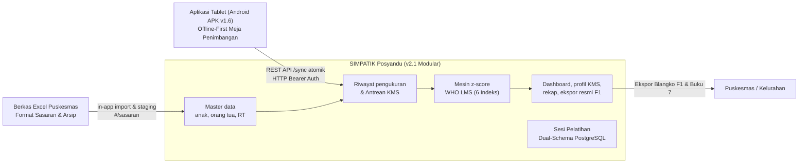

# Ringkasan SIMPATIK Posyandu

| | |
|---|---|
| **Jenis** | Orientasi |
| **Status** | Final Approved / v2.1-Modular |
| **Perubahan berarti terakhir** | 1 November 2026 |

Berkas pertama yang sebaiknya dibaca. Isinya: aplikasi ini apa, masalah apa yang dipecahkannya, siapa yang memakainya, dan di mana batasnya.

Apa saja yang bisa dilakukannya ada di [Fitur](fitur.md). Bagaimana ia disusun ada di [Handover Arsitektur Sistem](arsitektur-sistem-handover.md) dan [Arsitektur](arsitektur.md).

---

## Apa ini

SIMPATIK Posyandu — di dokumen disebut juga Portal Posyandu Tulip, atau cukup Portal — adalah aplikasi web internal untuk kader, Bidan, petugas KMS, admin, dan superadmin Posyandu Tulip RW 18. Portal menyimpan satu profil tetap per balita, satu riwayat pertumbuhan lintas bulan dan tahun, menghitung status gizi secara otomatis dari standar WHO LMS 2006 (PMK 2/2020), dan menghasilkan rekap yang selama ini disusun manual dari puluhan file Excel.

Portal adalah *system of record* dan pusat analitik. Pencatatan di meja penimbangan dilakukan melalui Aplikasi Tablet (Android APK v1.6) yang tersinkronisasi offline-first secara atomik ke REST API Portal (`/api/v1/pengukuran/sync`). Hasil ukur dari tablet langsung masuk ke antrean real-time Pemeriksaan KMS (`#/kms`) di Portal untuk diedukasikan kepada orang tua balita.

## Masalah yang dipecahkan

Arsip Posyandu Tulip sebelumnya tersebar di puluhan file Excel yang terbagi tiga sumbu sekaligus: per bulan, per jenis laporan, dan per indeks Z-score. Akibat yang terukur dari inventaris data:

| Gejala | Bukti dari arsip |
|---|---|
| Identitas anak tidak stabil | 1.054 baris rekap 2025 menghasilkan **129 variasi nama** untuk **124 NIK** terisi. Ada kolom `NAMA_BAKU`/`PERBAIKAN_NAMA` yang dipelihara manual. |
| Identitas tidak lengkap | 8 baris tanpa NIK; 4 NIK memiliki **tanggal lahir yang saling bertentangan** antar file. |
| Riwayat anak terputus | Untuk melihat pertumbuhan satu anak, petugas harus membuka 12 file atau lebih dan mencocokkan nama secara manual. |
| Perhitungan terduplikasi | Z-score dihitung ulang di tujuh file berbeda (`0_REKAP ... Z SCORE ...`), masing-masing dengan formula sendiri. |
| Tipe data rusak | Nilai `PINDAH RUMAH` muncul di kolom berat badan. NIK terbaca sebagai angka sehingga nol di depan hilang. Berat lahir tercatat `2986` (gram) bercampur dengan `2.9` (kg). |
| Duplikasi file | `6_JUNI 2026_MASTER Z SCORE.xlsx` ada identik di dua folder berbeda. |

Konsekuensinya: rekap bulanan memakan waktu berjam-jam, angka antar-laporan bisa berbeda, dan anak yang perlu tindak lanjut bisa terlewat karena riwayatnya tidak terbaca sebagai satu garis.

## Siapa yang memakainya

Portal bersifat **internal**. Tidak ada akses publik dan tidak ada akun untuk orang tua.

| Persona | Konteks | Kebutuhan utama |
|---|---|---|
| **Kader** | Relawan RW, umumnya bukan pengguna komputer harian. Mengurus anak-anak di RT binaannya. | Mencari anak dengan cepat, melihat riwayat dan status gizi anak binaannya, mengetahui kehadiran fisik (D/S). |
| **Petugas KMS** | Kader yang memegang meja edukasi KMS di hari penimbangan. | Membuka antrean balita hari H, melihat grafik kurva KIA, menjelaskan vonis gizi ke orang tua. |
| **Bidan / Koordinator** | Penanggung jawab kebenaran data dan keputusan klinis. | Mengoreksi profil dan pengukuran, memutuskan tindakan balita 2T+, melihat seluruh RT, menyiapkan bahan laporan Puskesmas. |
| **Admin sistem** | Mahasiswa KKN atau pengelola teknis posyandu. | Mengelola akun dan peran, menjalankan impor arsip, mengelola periode kegiatan, dan ekspor F1. |
| **Superadmin (Mirae)** | Pengelola global sistem multi-cluster posyandu. | Memantau seluruh klaster posyandu, memantau perangkat daring, dan mengontrol Sesi Pelatihan Sandbox. |

Peran diurutkan menaik: Kader < Petugas KMS < Bidan < Admin < Superadmin.

## Batas sistem

Seluruh jalur data kini telah **berdiri dan beroperasi**:

- **Impor sasaran Excel:** Modul in-app di `#/sasaran` memverifikasi struktur file, mendeteksi konflik NIK/nama/usia, staging pratinjau, dan menerbitkan ke basis data.
- **Aplikasi Tablet:** Tersinkronisasi dua arah via REST API `/api/v1/pengukuran/sync` dengan idempotensi payload dan proteksi transaksi database.
- **Pemeriksaan KMS:** Data ukur dari tablet langsung masuk ke antrean real-time di layar `#/kms`.
- **Ekspor Blangko F1:** Menghasilkan file Excel berformat resmi Puskesmas (22 butir F1 Gizi dan Buku 7 per RT).

